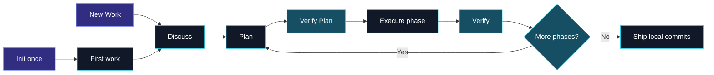

<div align="center">
  
  <h1>Phasecraft</h1>
  <p><strong>Evidence-first engineering, one deliberate phase at a time.</strong></p>
  <p>
    A local coding-agent workflow that turns context into verified plans, controlled execution,
    independent checks, and exact local commits.
  </p>
  <p><strong>One workflow package for OpenCode, Claude Code, Codex, and Pi.</strong></p>
  <p>
    
    
    
    
    
    
  </p>
  <p>
    <a href="#installation">Installation</a> &middot;
    <a href="#worked-example">Example</a> &middot;
    <a href="#workflow">Workflow</a> &middot;
    <a href="#safety-model">Safety</a> &middot;
    <a href="#documentation">Documentation</a>
  </p>
</div>

---

## 🧭 Why Phasecraft?

AI-assisted implementation becomes risky when context, assumptions, code changes, and commits blur into one conversation. Phasecraft creates explicit boundaries between them.

| Without a workflow | With Phasecraft |
| --- | --- |
| Repository claims are recalled or guessed | Claims carry evidence IDs and source hashes |
| Planning and implementation happen together | Plans are independently audited before execution |
| Scope expands silently | Material deviations stop and return to planning |
| Dirty work can leak into commits | Baselines block or explicitly adopt pre-existing changes |
| Approval means “roughly this” | Ship approval is bound to exact files, diffs, checks, and messages |
| Agents push work immediately | Phasecraft creates local commits only and never pushes |

Phasecraft is intentionally local and inspectable. Semantic work lives in host-specific commands, skills, and agent roles; deterministic state, Git, validation, and rendering operations live in plain Node.js modules. Generated application-flow diagrams use a pinned Mermaid browser renderer. Agents validate diagram source and generated HTML structure without Playwright or browser automation; humans own visual review and can request artifact revisions.

### Who it is for

Phasecraft is most useful when a change has real scope, risk, or review cost:

- API, database, payment, authorization, migration, and integration work.
- Teams that want AI-generated plans and changes to remain inspectable in Git.
- Repositories where unrelated dirty files must not leak into a commit.
- Work that benefits from a separate planner, executor, and verifier.

For a typo or a tiny one-file edit, the full workflow may be more ceremony than you need.

## Supported Hosts

The same runtime and workflow contracts are projected into each host during installation.

| Host | Install value | Invoke a stage | Integration |
| --- | --- | --- | --- |
| OpenCode | `opencode` | `/phasecraft-plan` | Commands, scoped agents, and shared skill |
| Claude Code | `claude` | `/phasecraft-plan` | Commands, project agents, and shared skill |
| Codex | `codex` | `$phasecraft-plan` | Agent Skills and named agent TOML files |
| Pi | `pi` | `/phasecraft-plan` | Prompt templates, shared skill, and a policy extension |

The deterministic state, artifact, review, and Git controls are identical. Host-level permission capabilities differ; see [Host Compatibility](docs/HOSTS.md) before enabling unattended tool access.

<a id="installation"></a>

## ⚡ Installation

### Requirements

- OpenCode, Claude Code, Codex, or Pi
- Node.js 20 or newer
- Git worktree

### Install from npm

Run the command from your application repository. Choose the host you use:

```bash
# OpenCode
npx @ahmadhafizh16/phasecraft@latest install --host opencode

# Claude Code
npx @ahmadhafizh16/phasecraft@latest install --host claude

# Codex
npx @ahmadhafizh16/phasecraft@latest install --host codex

# Pi
npx @ahmadhafizh16/phasecraft@latest install --host pi
```

Use `--target` when installing into another repository, or install every adapter for a shared project:

```bash
npx @ahmadhafizh16/phasecraft@latest install --host claude --target /path/to/project
npx @ahmadhafizh16/phasecraft@latest install --host all --target /path/to/your/project
```

The target is the application project root. Restart OpenCode, Claude Code, or Codex after installation; in Pi, run `/reload`. See the [host compatibility guide](docs/HOSTS.md) for generated layouts and safety differences.

### Install from source

```bash
git clone https://github.com/ahmadhafizh16/phasecraft.git
node phasecraft/bin/phasecraft.mjs install --host claude --target /path/to/project
```

Use source installation when developing Phasecraft or before the npm release is available.

### Initialize a project once

```text
/phasecraft-init
```

Init confirms artifact tracking, configures the work-path template, selects and hashes authoritative project documents, and creates the first work item.

OpenCode, Claude Code, and Pi use `/phasecraft-*` commands. Codex exposes the same stages as `$phasecraft-*` skills.

Init asks you to confirm:

- Whether workflow artifacts stay local or are reviewable in Git.
- How work paths should be organized, such as `features/{feature}/tasks/{id}-{slug}`.
- Which repository documents are authoritative.
- The first work item and its clean or dirty Git baseline.

### Create later work without reinitializing

```text
/phasecraft-new-work PAY-143 Refund webhook support
```

Arguments are suggestions. Phasecraft confirms the work ID, title, template values, branch association, exact artifact path, and fresh Git baseline before creation.

<a id="worked-example"></a>

## Worked Example

Imagine you need to prevent duplicate payment captures when a provider retries a callback.

The examples below use slash-command syntax. In Codex, invoke the equivalent skill with `$phasecraft-*`.

### 1. Discuss the change

```text
/phasecraft-discuss --work PAY-142

## Product Context
Provider callbacks may be delivered more than once. A payment must be captured at most once.

## Database Context
The payments table already stores provider_reference but has no unique constraint.

## Desired Outcome
Duplicate callbacks return the existing payment result without issuing another capture.

## Constraints
Keep the current callback response contract and do not push automatically.
```

The discussion does not silently become fact. Phasecraft may record results such as:

```text
E-001  The callback handler currently calls capturePayment before persistence.
E-002  payments.provider_reference is indexed but not unique.
D-001  Preserve the current successful callback response.
P-001  Claim the provider reference transactionally before capture.
U-001  Confirm whether historical duplicate references exist before migration.
R-001  A uniqueness migration can fail when historical duplicates are present.
```

### 2. Generate and review the plan

```text
/phasecraft-plan --work PAY-142
/phasecraft-verify-plan --work PAY-142
```

The authoritative plan is Markdown. A technical-change excerpt is explicit about current evidence, proposed behavior, affected code, and observable output:

````markdown
### CH-001: Claim callback idempotency before capture
- Change type: code
- File: src/payments/provider-callback.ts
- Symbol: handleProviderCallback
- Before: E-001 captures before durable duplicate detection.
- Proposed after: PROPOSED P-001 claims the provider reference transactionally.
- Database changes: add a unique provider_reference constraint after duplicate cleanup
- API changes: preserve the existing successful callback response
- Flow impact: F-001 routes duplicate callbacks to the stored payment result.

#### Expected result
```json
{
  "paymentId": "pay_123",
  "captured": true,
  "duplicate": true
}
```
````

After rendering, Phasecraft opens a local review page. You can comment on a requirement, code proposal, application-flow node mapping, task, risk, or selected text. Publishing comments creates an immutable feedback batch such as `FB-001`; it does not run an agent or edit source automatically.

```text
/phasecraft-plan --work PAY-142 --feedback FB-001
```

### 3. Execute, verify, and ship locally

```text
/phasecraft-execute --work PAY-142
/phasecraft-verify --work PAY-142
/phasecraft-ship --work PAY-142
```

Before creating commits, Ship shows the exact bound preview:

```text
HEAD:                 8ca4d52...
Commit group:         C-001 fix: make payment callbacks idempotent
Files:                migration.sql, provider-callback.ts, provider-callback.test.ts
Automatic checks:     14 passed, 0 failed
Pending manual checks: none
Approval fingerprint: 96d79f0...
Push:                 false
```

If `HEAD`, a file, a diff, a check result, or the worktree changes after approval, Ship aborts and requires a new preview.

<a id="workflow"></a>

## 🔄 Workflow

Project setup happens once. Every work item then moves through explicit commands, and each command performs only one stage.



### Command Surface

| Command | Responsibility |
| --- | --- |
| `/phasecraft-init` | Configure Phasecraft once and create the first work item. |
| `/phasecraft-new-work` | Create each later feature or task with a fresh baseline. |
| `/phasecraft-discuss` | Establish scope, decisions, evidence, risks, proposals, and unknowns. |
| `/phasecraft-plan` | Maintain the roadmap, detail the next executable phase, and process an explicit `--feedback FB-NNN` batch. |
| `/phasecraft-verify-plan` | Independently audit the plan, then ask you to fix, defer, accept, or mark each semantic finding non-blocking. |
| `/phasecraft-execute` | Execute the entire approved phase without committing. |
| `/phasecraft-verify` | Independently compare decisions, plan, implementation, and checks. |
| `/phasecraft-ship` | Preview and create exact approved local commit groups. Never push. |
| `/phasecraft-status` | Report state, drift, blockers, pending checks, and the next legal command. |

Pass `--work <id>` when several work items are open. If omitted, Phasecraft resolves by branch association or the sole open item; ambiguity requires user selection.

After Plan validates and renders the active phase, it starts a capability-protected review UI on `127.0.0.1` and opens the default browser. Use `PHASECRAFT_NO_BROWSER=1` in headless environments; Phasecraft still returns the local URL. Enable Comment mode to annotate requirement, change, flow, task, risk, code/result, table, or evidence anchors, or select text inside one anchor. Drafts are private and survive server restarts. Publishing creates immutable `FB-NNN` artifacts and copies an explicit planner command; it never launches an agent automatically.

## 🧩 Evidence Model

Phasecraft never silently promotes a claim into a fact.

| Identity | Meaning | Example |
| --- | --- | --- |
| `E-*` | Verified repository, command, project-document, or approved external evidence | `E-004` confirms the current API retry behavior |
| `D-*` | Explicit user decision | `D-002` keeps the existing response contract |
| `P-*` | Proposed solution, not a present fact | `P-003` introduces bounded retries |
| `U-*` | Unresolved unknown | `U-001` needs provider timeout confirmation |
| `R-*` | Risk with impact, mitigation, possible solution, and evidence | `R-002` covers duplicate side effects |

Execution-critical `U-*` references and current-state descriptions without `E-*` become explicit semantic findings. The human may fix, defer, accept, or mark them non-blocking after seeing the consequence. Future states stay labeled `PROPOSED` or cite `P-*`.

Verify Plan does not require a perfect plan. Approval-binding failures remain non-waivable, but stale evidence, missing checks, incomplete detail, and other engineering risks return to you as Q&A. You can request a fix now, defer the item to a named phase or trigger, accept the risk with mitigation and guardrails, explicitly accept it with no current mitigation, or record it as non-blocking. Exact-plan-hash decisions remain in `PLAN-VERIFICATION.md`; accepted risks remain in `plan/RISK-REGISTER.md`, and deferred work remains in `plan/DEFERRED-FINDINGS.md` until its trigger is due. After revision, Verify Plan audits changed semantic anchors and affected dependencies, then asks once before carrying unchanged dispositions to the new plan hash.

## 🗂️ Project Artifacts

The configured template can organize work by feature, task, team, or another project convention:

```text
features/{feature}/tasks/{id}-{slug}
```

Reviewable artifacts and private runtime state remain separated:

```text
.phasecraft/
├── config.json
├── general_knowledge/
│   ├── SOURCES.json
│   └── PROJECT.md
├── work/<confirmed-template-path>/
│   ├── CONTEXT.md
│   ├── handoffs/<agent>/H-001.md
│   ├── research/
│   │   ├── RESEARCH.md
│   │   └── EVIDENCE.json
│   ├── plan/
│   │   ├── DEFERRED-FINDINGS.md
│   │   ├── RISK-REGISTER.md
│   │   ├── ROADMAP.md
│   │   ├── roadmap.html
│   │   └── phases/P-01-<slug>/
│   │       ├── PLAN.md
│   │       ├── plan.html
│   │       └── PLAN-VERIFICATION.md
│   ├── feedback/
│   │   ├── FB-001.md
│   │   └── FB-001-RESOLUTION.md
│   ├── verification/
│   └── ship/SHIP.md
└── .local/
    ├── registry.json
    ├── locks/
    └── work/<stable-key>/
        ├── state.json
        ├── BASELINE.json
        ├── execution/phases/P-01/patches/
        ├── reviews/
        │   ├── sessions/current.json
        │   ├── drafts/
        │   └── batches/
        └── ship/
```

| Mode | Repository behavior |
| --- | --- |
| `local` | Adds `/.phasecraft/` to the repository-local `.git/info/exclude`. |
| `reviewable` | Excludes only `/.phasecraft/.local/`; decisions, evidence, plans, and verification can be reviewed or committed manually. |

Markdown is authoritative. `roadmap.html` is a strategic phase atlas, while `plan.html` is an implementation review cockpit for syntax-highlighted before/proposed code and concrete expected results, Mermaid BEFORE/AFTER application-flow comparisons, surgical node-to-file/symbol mappings, database/API/flow impact, migration and rollback detail, requirement coverage, task flow, file impact, risks, row-based manual checks, and commits. The roadmap visibly declares whole-work/all-phase scope. Every plan visibly declares its current executable `P-NN`, states that it authorizes only that phase, and labels other phase-owned flows as future context. Phase plans retain canonical filenames but live in separate `P-NN-<slug>/` directories, so later plans never overwrite earlier ones. Evidence identities link to reference cards with their claim, provenance, and status. Both views are escaped, bound to their Markdown SHA-256, and carry deterministic semantic review anchors. Standalone plans may load pinned Mermaid `11.4.1`; authenticated review mode blocks all artifact scripts and preserves readable Mermaid source so third-party code cannot access the local review origin.

Every Phasecraft agent invocation also writes an immutable, atomically sequenced `handoffs/<agent>/H-NNN.md`. Handoffs preserve exact navigation and resume context across repeated agent rounds, but never replace evidence, plans, state, execution records, or verification artifacts.

<a id="safety-model"></a>

## 🛡️ Safety Model

### Git boundaries

- Init and New Work capture `HEAD`, branch, status, dirty files, and content hashes.
- Baseline-dirty files are blocked until restored to `HEAD` and recorded as clean, or explicitly adopted.
- Execute cannot commit, push, reset, switch branches, or clean the worktree.
- Recovery patches are cumulative, binary-capable, mode `0600`, size-bounded, and local-only.
- Commit groups use whole files. Groups sharing files merge transitively and honor dependencies.
- Ship requires a clean index and exact approval of `HEAD`, worktree fingerprint, binary-capable diffs, files, messages, checks, and pending manual checks.
- Any drift invalidates approval. Ship creates local commits and reports `pushed: false`.

### Agent boundaries

| Agent | Source edits | Network | Git commits |
| --- | ---: | ---: | ---: |
| Manager / Planner / Auditors | No | No | No |
| Researcher | Workflow artifacts only | Per-request approval | No |
| Executor | Approved phase files | No | No |
| Shipper | No | No | Runtime-controlled only |

Models are inherited from the selected coding host and project configuration. Phasecraft does not hardcode a provider or model.

<a id="architecture"></a>

## 🏗️ Architecture

| Area | Files | Purpose |
| --- | --- | --- |
| CLI | `runtime/phasecraft.mjs` | Argument parsing and deterministic command routing |
| State | `runtime/state.mjs` | Safe templates, registry, revisions, locks, and legal transitions |
| Knowledge | `runtime/knowledge.mjs` | Authority discovery, source hashing, and drift detection |
| Artifacts | `runtime/artifacts.mjs` | Evidence, roadmap, and restricted plan validation |
| Handoffs | `runtime/handoffs.mjs` | Validated immutable agent handoff allocation and discovery |
| Renderer | `runtime/render.mjs` | Safe deterministic plan and roadmap HTML |
| Feedback | `runtime/feedback.mjs` | Private drafts, immutable feedback batches, and planner resolutions |
| Review | `runtime/review.mjs`, `runtime/review-ui.mjs` | Authenticated loopback server and responsive annotation shell |
| Git | `runtime/git.mjs` | Baselines, patches, groups, previews, and local Ship |
| Canonical host prompts | `opencode/` | Nine workflow commands, seven scoped roles, and the shared skill |
| Host projections | `bin/hosts.mjs`, `pi/phasecraft.ts` | OpenCode, Claude Code, Codex, and Pi layouts and policy adapters |
| Installer | `bin/install.mjs`, `bin/phasecraft.mjs` | Conflict-safe host installation, linking, health checks, updates, and uninstall |

Each adapter bundles the same runtime under its host directory. Inspect the package runtime commands with:

```bash
npx @ahmadhafizh16/phasecraft@latest runtime help
```

## 📦 Installer Operations

```bash
# Self-contained project install
npx @ahmadhafizh16/phasecraft@latest install --host claude --target /path/to/project

# Install all supported host adapters
npx @ahmadhafizh16/phasecraft@latest install --host all --target /path/to/project

# Update an existing managed install
npx @ahmadhafizh16/phasecraft@latest install --host claude --target /path/to/project

# Non-mutating health check
npx @ahmadhafizh16/phasecraft@latest check --host claude --target /path/to/project

# Remove only unchanged managed files
npx @ahmadhafizh16/phasecraft@latest uninstall --host claude --target /path/to/project

# Individual-file symlinks for Phasecraft development
node bin/install.mjs install --host claude --target /path/to/project --link
```

Each host has an independent manifest, so several adapters can coexist. Generated prompts remain hashed managed files in link mode, while static runtime files are symlinked. The installer never edits host settings, silently overwrites modified managed files, removes unrelated files, or touches application Git history.

## 🧪 Development

```bash
npm run check
npm test
```

The `node:test` suite uses temporary Git repositories and covers state transitions, path safety, authority drift, research consent, plan validation, hostile HTML escaping, deterministic source generation, application-flow contracts, durable handoffs, baseline handling, recovery patches, commit-group merging, exact Ship drift detection, local commits, installer safety, and all host projections.

<a id="documentation"></a>

## 📚 Documentation

| Document | Contents |
| --- | --- |
| [Specification](docs/SPEC.md) | Behavioral contract, state machine, evidence, and Git safety |
| [Artifact schemas](docs/ARTIFACT-SCHEMAS.md) | Exact project tree, JSON records, and restricted Markdown grammar |
| [Host compatibility](docs/HOSTS.md) | Installation layouts, invocation syntax, and host safety differences |
| [Roadmap](ROADMAP.md) | Implementation phases, delivered capabilities, and deferred scope |

## 🚧 Current Scope

Phasecraft deliberately does **not** provide:

- Git push or pull-request creation
- Jira or other issue-tracker APIs
- CI orchestration
- Hunk-based separation of pre-existing changes
- Automatic secret redaction
- Native Windows support outside WSL
- A hosted dashboard or remote service

## 📄 License

MIT. See [LICENSE](LICENSE).
