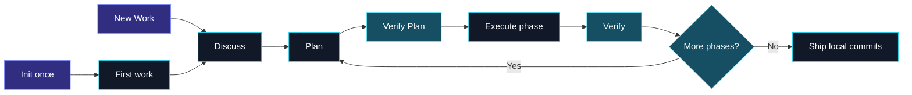

<div align="center">
  
  <h1>Phasecraft</h1>
  <p><strong>Evidence-first engineering, one deliberate phase at a time.</strong></p>
  <p>
    A local OpenCode workflow that turns context into verified plans, controlled execution,
    independent checks, and exact local commits.
  </p>
  <p>
    
    
    
    
    
  </p>
  <p>
    <a href="#quick-start">Quick start</a> &middot;
    <a href="#workflow">Workflow</a> &middot;
    <a href="#safety-model">Safety</a> &middot;
    <a href="#architecture">Architecture</a> &middot;
    <a href="#documentation">Documentation</a>
  </p>
</div>

---

## 🧭 Why Phasecraft?

AI-assisted implementation becomes risky when context, assumptions, code changes, and commits blur into one conversation. Phasecraft creates explicit boundaries between them.

| Without a workflow | With Phasecraft |
| --- | --- |
| Repository claims are recalled or guessed | Claims carry evidence IDs and source hashes |
| Planning and implementation happen together | Plans are independently audited before execution |
| Scope expands silently | Material deviations stop and return to planning |
| Dirty work can leak into commits | Baselines block or explicitly adopt pre-existing changes |
| Approval means “roughly this” | Ship approval is bound to exact files, diffs, checks, and messages |
| Agents push work immediately | Phasecraft creates local commits only and never pushes |

Phasecraft is intentionally local and inspectable. The semantic work lives in OpenCode agents; deterministic state, Git, validation, and rendering operations live in plain Node.js modules. Generated application-flow diagrams use a pinned Mermaid browser renderer. Agents validate diagram source and generated HTML structure without Playwright or browser automation; humans own visual review and can request artifact revisions.

<a id="quick-start"></a>

## ⚡ Quick Start

### Requirements

- [OpenCode](https://opencode.ai/)
- Node.js 20 or newer
- Git

### 1. Clone and install

```bash
git clone git@github.com:ahmadhafizh16/phasecraft.git
cd phasecraft
node bin/install.mjs --target /path/to/your/project
```

The target is the application project root, not its `.opencode` directory. Restart OpenCode after installation, then launch it from that project:

```bash
opencode /path/to/your/project
```

### 2. Initialize the project once

```text
/phasecraft-init
```

Init confirms artifact tracking, configures the work-path template, selects and hashes authoritative project documents, and creates the first work item.

### 3. Create later work without reinitializing

```text
/phasecraft-new-work MRS-4801 PDF authorization update
```

Arguments are suggestions. Phasecraft confirms the work ID, title, template values, branch association, exact artifact path, and fresh Git baseline before creation.

### 4. Start the evidence discussion

```text
/phasecraft-discuss --work MRS-4801

## PRD Context
1. Current user problem and acceptance criteria

## Database Context
1. Relevant tables, constraints, and migration concerns

## Third-Party API Context
1. Provider behavior, endpoints, limits, and failure modes

## Desired Outcome
The behavior we need after this work is complete.
```

This text seeds the discussion; it does not become fact automatically. Phasecraft verifies technical claims, records decisions, preserves unknowns, and requests permission before each external research lookup.

<a id="workflow"></a>

## 🔄 Workflow

Project setup happens once. Every work item then moves through explicit commands, and each command performs only one stage.



### Command Surface

| Command | Responsibility |
| --- | --- |
| `/phasecraft-init` | Configure Phasecraft once and create the first work item. |
| `/phasecraft-new-work` | Create each later feature or task with a fresh baseline. |
| `/phasecraft-discuss` | Establish scope, decisions, evidence, risks, proposals, and unknowns. |
| `/phasecraft-plan` | Maintain the roadmap and detail only the next executable phase. |
| `/phasecraft-verify-plan` | Independently audit the plan, then ask you to fix, defer, accept, or mark each semantic finding non-blocking. |
| `/phasecraft-execute` | Execute the entire approved phase without committing. |
| `/phasecraft-verify` | Independently compare decisions, plan, implementation, and checks. |
| `/phasecraft-ship` | Preview and create exact approved local commit groups. Never push. |
| `/phasecraft-status` | Report state, drift, blockers, pending checks, and the next legal command. |

Pass `--work <id>` when several work items are open. If omitted, Phasecraft resolves by branch association or the sole open item; ambiguity requires user selection.

## 🧩 Evidence Model

Phasecraft never silently promotes a claim into a fact.

| Identity | Meaning | Example |
| --- | --- | --- |
| `E-*` | Verified repository, command, project-document, or approved external evidence | `E-004` confirms the current API retry behavior |
| `D-*` | Explicit user decision | `D-002` keeps the existing response contract |
| `P-*` | Proposed solution, not a present fact | `P-003` introduces bounded retries |
| `U-*` | Unresolved unknown | `U-001` needs provider timeout confirmation |
| `R-*` | Risk with impact, mitigation, possible solution, and evidence | `R-002` covers duplicate side effects |

Execution-critical `U-*` references block plan approval. Current-state technical descriptions require `E-*`; future states stay labeled `PROPOSED` or cite `P-*`.

Verify Plan does not require a perfect first plan. Mechanical integrity failures remain non-waivable, but engineering findings return to you as Q&A. You can request a fix now, defer the item to a named phase or trigger, accept the risk for speed with explicit guardrails, or record it as non-blocking. The exact-plan-hash decisions remain in `PLAN-VERIFICATION.md`; deferred work remains visible in `plan/DEFERRED-FINDINGS.md` until its trigger is due and resolution is recorded.

## 🗂️ Project Artifacts

The configured template can organize work by feature, task, team, or another project convention:

```text
features/{feature}/tasks/{id}-{slug}
```

Reviewable artifacts and private runtime state remain separated:

```text
.phasecraft/
├── config.json
├── general_knowledge/
│   ├── SOURCES.json
│   └── PROJECT.md
├── work/<confirmed-template-path>/
│   ├── CONTEXT.md
│   ├── handoffs/<agent>/H-001.md
│   ├── research/
│   │   ├── RESEARCH.md
│   │   └── EVIDENCE.json
│   ├── plan/
│   │   ├── DEFERRED-FINDINGS.md
│   │   ├── ROADMAP.md
│   │   ├── roadmap.html
│   │   └── phases/P-01-<slug>/
│   │       ├── PLAN.md
│   │       ├── plan.html
│   │       └── PLAN-VERIFICATION.md
│   ├── verification/
│   └── ship/SHIP.md
└── .local/
    ├── registry.json
    ├── locks/
    └── work/<stable-key>/
        ├── state.json
        ├── BASELINE.json
        ├── execution/phases/P-01/patches/
        └── ship/
```

| Mode | Repository behavior |
| --- | --- |
| `local` | Adds `/.phasecraft/` to the repository-local `.git/info/exclude`. |
| `reviewable` | Excludes only `/.phasecraft/.local/`; decisions, evidence, plans, and verification can be reviewed or committed manually. |

Markdown is authoritative. `roadmap.html` is a strategic phase atlas, while `plan.html` is an implementation review cockpit for syntax-highlighted before/proposed code and concrete expected results, Mermaid BEFORE/AFTER application-flow comparisons, surgical node-to-file/symbol mappings, database/API/flow impact, migration and rollback detail, requirement coverage, task flow, file impact, risks, row-based manual checks, and commits. The roadmap visibly declares whole-work/all-phase scope. Every plan visibly declares its current executable `P-NN`, states that it authorizes only that phase, and labels other phase-owned flows as future context. Phase plans retain canonical filenames but live in separate `P-NN-<slug>/` directories, so later plans never overwrite earlier ones. Evidence identities link to reference cards with their claim, provenance, and status. Both views are escaped and bound to their Markdown SHA-256. Plans with application flows load pinned Mermaid `11.4.1` from jsDelivr and preserve readable diagram source as fallback.

Every Phasecraft agent invocation also writes an immutable, atomically sequenced `handoffs/<agent>/H-NNN.md`. Handoffs preserve exact navigation and resume context across repeated agent rounds, but never replace evidence, plans, state, execution records, or verification artifacts.

<a id="safety-model"></a>

## 🛡️ Safety Model

### Git boundaries

- Init and New Work capture `HEAD`, branch, status, dirty files, and content hashes.
- Baseline-dirty files are blocked until restored to `HEAD` and recorded as clean, or explicitly adopted.
- Execute cannot commit, push, reset, switch branches, or clean the worktree.
- Recovery patches are cumulative, binary-capable, mode `0600`, size-bounded, and local-only.
- Commit groups use whole files. Groups sharing files merge transitively and honor dependencies.
- Ship requires a clean index and exact approval of `HEAD`, worktree fingerprint, binary-capable diffs, files, messages, checks, and pending manual checks.
- Any drift invalidates approval. Ship creates local commits and reports `pushed: false`.

### Agent boundaries

| Agent | Source edits | Network | Git commits |
| --- | ---: | ---: | ---: |
| Manager / Planner / Auditors | No | No | No |
| Researcher | Workflow artifacts only | Per-request approval | No |
| Executor | Approved phase files | No | No |
| Shipper | No | No | Runtime-controlled only |

Models are inherited from the target project's OpenCode configuration. Phasecraft does not hardcode a provider or model.

<a id="architecture"></a>

## 🏗️ Architecture

| Area | Files | Purpose |
| --- | --- | --- |
| CLI | `runtime/phasecraft.mjs` | Argument parsing and deterministic command routing |
| State | `runtime/state.mjs` | Safe templates, registry, revisions, locks, and legal transitions |
| Knowledge | `runtime/knowledge.mjs` | Authority discovery, source hashing, and drift detection |
| Artifacts | `runtime/artifacts.mjs` | Evidence, roadmap, and restricted plan validation |
| Handoffs | `runtime/handoffs.mjs` | Validated immutable agent handoff allocation and discovery |
| Renderer | `runtime/render.mjs` | Safe deterministic plan and roadmap HTML |
| Git | `runtime/git.mjs` | Baselines, patches, groups, previews, and local Ship |
| OpenCode package | `opencode/` | Nine commands, seven scoped agents, and the shared skill |
| Installer | `bin/install.mjs` | Conflict-safe copy, link, check, update, and uninstall |

The installed runtime lives at `.opencode/phasecraft/runtime/phasecraft.mjs`. Inspect its machine-facing commands with:

```bash
node runtime/phasecraft.mjs help
```

## 📦 Installer Operations

```bash
# Self-contained project copy (default)
node bin/install.mjs --target /path/to/project

# Individual-file symlinks for Phasecraft development
node bin/install.mjs --target /path/to/project --link

# Non-mutating health check
node bin/install.mjs --target /path/to/project --check

# Remove only unchanged managed files
node bin/install.mjs --target /path/to/project --uninstall
```

The installer never edits `opencode.json`, silently overwrites modified managed files, removes unrelated files, or touches application Git history.

## 🧪 Development

```bash
npm run check
npm test
```

The `node:test` suite uses temporary Git repositories and covers state transitions, path safety, authority drift, research consent, plan validation, hostile HTML escaping, deterministic source generation, application-flow contracts, durable handoffs, baseline handling, recovery patches, commit-group merging, exact Ship drift detection, local commits, installer safety, and OpenCode package discovery.

<a id="documentation"></a>

## 📚 Documentation

| Document | Contents |
| --- | --- |
| [Specification](docs/SPEC.md) | Behavioral contract, state machine, evidence, and Git safety |
| [Artifact schemas](docs/ARTIFACT-SCHEMAS.md) | Exact project tree, JSON records, and restricted Markdown grammar |
| [Roadmap](ROADMAP.md) | v0.1 implementation phases, conformance work, and deferred scope |

## 🚧 Current Scope

Phasecraft v0.1 deliberately does **not** provide:

- Git push or pull-request creation
- Jira or other issue-tracker APIs
- CI orchestration
- Hunk-based separation of pre-existing changes
- Automatic secret redaction
- Native Windows support outside WSL
- A hosted dashboard or remote service

## 📄 License

No license file has been added yet.
