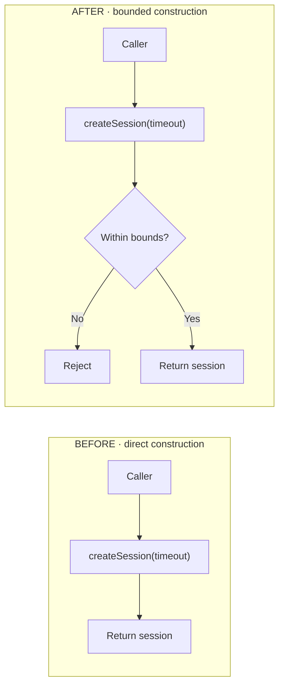

# Phasecraft Artifact Schemas

Version 1 artifacts use JSON for machine state and restricted Markdown for reviewable engineering records. Markdown is authoritative; HTML is derivative.

## Project Tree

```text
.phasecraft/
├── config.json
├── general_knowledge/
│   ├── SOURCES.json
│   └── PROJECT.md
├── work/
│   └── <confirmed template path>/
│       ├── CONTEXT.md
│       ├── handoffs/
│       │   └── phasecraft-planner/
│       │       ├── H-001.md
│       │       └── H-002.md
│       ├── research/
│       │   ├── RESEARCH.md
│       │   └── EVIDENCE.json
│       ├── plan/
│       │   ├── DEFERRED-FINDINGS.md
│       │   ├── RISK-REGISTER.md
│       │   ├── ROADMAP.md
│       │   ├── roadmap.html
│       │   └── phases/P-01-<slug>/
│       │       ├── PLAN.md
│       │       ├── plan.html
│       │       ├── PLAN-VERIFICATION.md
│       │       └── versions/v1/
│       │           ├── PLAN.md
│       │           ├── plan.html
│       │           ├── PLAN-VERIFICATION.md
│       │           └── SUPERSEDED.json
│       ├── verification/phases/P-01-<slug>/VERIFICATION.md
│       └── ship/SHIP.md
└── .local/
    ├── registry.json
    ├── locks/
    └── work/<stable-key>/
        ├── state.json
        ├── BASELINE.json
        ├── execution/phases/P-01/patches/T-001.patch
        └── ship/
            ├── preview.json
            └── result.json
```

Init creates project configuration and the first work directories. New Work creates the same isolated work directories for every later feature/task. Stage agents create semantic Markdown as work advances.

## Config

`.phasecraft/config.json`:

```json
{
  "schemaVersion": 1,
  "artifactMode": "local",
  "workPathTemplate": "features/{feature}/tasks/{id}-{slug}",
  "sensitivePaths": [".env", ".env.*", "*.pem", "*.key", "*credentials*", "*secret*"],
  "snapshotMaxBytes": 10485760,
  "createdAt": "ISO-8601",
  "updatedAt": "ISO-8601"
}
```

`artifactMode` is `local` or `reviewable`. Template placeholders are prompted values; `{id}` comes from the confirmed work id and `{slug}` may be derived from the title.

## Authority Registry

`general_knowledge/SOURCES.json` contains `schemaVersion`, `hashAlgorithm`, `confirmedAt`, and ordered `sources`. Each source has `path`, `authority`, `reason`, `order`, `hash`, and `bytes`. Drift checks recompute every hash and report `current`, `stale`, or `missing`.

## Evidence Registry

`research/EVIDENCE.json`:

```json
{
  "schemaVersion": 1,
  "entries": [
    {
      "id": "E-001",
      "type": "evidence",
      "claim": "Observed behavior",
      "source": {
        "kind": "repository",
        "locator": "src/file.mjs:createThing",
        "hash": "64 lowercase hex characters"
      },
      "status": "verified"
    }
  ]
}
```

Allowed types and matching prefixes are `evidence/E`, `decision/D`, `proposal/P`, `unknown/U`, and `risk/R`. IDs use at least three digits and are unique. Every entry requires a claim, source kind, source locator, and status. `E-*` requires a source SHA-256. A syntactically valid but unregistered identity produces a semantic `REFERENCE_MISSING` warning in a plan so the human may disposition the unsupported claim; an invalid evidence registry remains a structural error.

## Roadmap Markdown

`ROADMAP.md` requires one level-one title and these exact level-two sections:

```text
Objective
Requirements
Phases
Risks
Unknowns
```

Requirements use:

```markdown
- REQ-001: Testable requirement.
```

Every phase is a level-three entry:

```markdown
### P-01: Phase title
- Goal: Summary outcome.
- Requirements: REQ-001
- Depends on: none
- Exit evidence: Observable completion evidence.
- Status: next
```

Risks may be `None.` or use the risk entry grammar below.

## Plan Markdown

`PLAN.md` requires one level-one title and these exact level-two sections:

```text
Goal
Inputs
Requirements
Technical Design
Tasks
Risk Controls
Commit Groups
Manual Checks
```

It may additionally include `Application Flows` after `Technical Design`. The section becomes required by the planning/audit contract when any technical change declares non-`none` flow impact.

Requirements use `- REQ-001: description`.

### Technical Change

````markdown
### CH-001: Change title
- Change type: code
- File: src/file.mjs
- Symbol: exportedFunction
- Before: E-001 describes the verified current state.
- Proposed after: PROPOSED P-001 describes the target state.
- Reason: Why this change is required.
- Database changes: none
- API changes: none
- Flow impact: F-001 validates input before the existing function performs its side effect.

#### Before code
```js
export function exportedFunction(input) {
  return existingBehavior(input);
}
```

#### Proposed code
```js
export function exportedFunction(input) {
  return proposedBehavior(input);
}
```

#### Expected result
```json
{
  "accepted": true,
  "value": "observable post-change result"
}
```
````

`Before` must cite `E-*`. `Proposed after` must contain `PROPOSED` or cite `P-*`. `Change type`, `Database changes`, `API changes`, and `Flow impact` are optional schema fields for compatibility with existing plans but produce completeness warnings when omitted. The fenced `Before code` and `Proposed code` blocks must contain concrete code, configuration, schema, or contract snapshots precise enough to expose the planned implementation delta. `Expected result` shows the resulting persisted object/config/index, API request/response, returned object, emitted event, generated report, or test observation. Database examples contain complete representative records with required defaults, controls, provenance, and forbidden-field absence rather than fragments. Fence languages drive deterministic syntax highlighting; supported highlighters include JavaScript/TypeScript aliases, JSON, SQL, and shell aliases, while unknown languages remain safely escaped plain text.

When `Database changes` is not `none`, add both blocks:

````markdown
#### Database migration
```sql
ALTER TABLE example ADD COLUMN value TEXT;
```

#### Rollback plan
```sql
ALTER TABLE example DROP COLUMN value;
```
````

When `Flow impact` is not exact `none`, it references one or more application-flow IDs such as `F-001`.

### Application Flow

````markdown
## Application Flows
### F-001: Session creation timeout validation
- Surface: Internal session creation
- Entry point: src/session.mjs:createSession
- Phase: P-01
- Before: E-001 constructs a session directly from the supplied timeout.
- After: PROPOSED P-001 validates before construction and rejects unsupported values.
- Evidence: E-001, D-001, P-001

#### Diagram


#### Change points
```changes
A2 | P-01 | src/session.mjs | createSession | Insert the bounds assertion before constructing session state.
A3 | P-01 | src/session.mjs | createSession | Branch invalid input to rejection and valid input to the existing constructor.
```
````

Application flows describe user-facing or operational behavior, not task order or one low-level validator/index. Use one `F-*` per materially different surface. `Surface` names the affected API/job/command, `Entry point` names the verified repository symbol, and `Phase` assigns implementation ownership. Use `flowchart LR` with separate `BEFORE` and `AFTER` subgraphs, `direction TB` inside both, and no crossover edges. Include complete business stages such as API calls, eligibility, discounts, final comparison, persistence before external side effects, fallback, and selected response. Every behavior-changing AFTER node maps through `Change points` using `Mermaid node | Phase | File | Symbol | Surgical change`; the node must exist in the diagram, and later-phase mappings must be re-verified during just-in-time planning. Known later-phase flows may be recorded for feature context without authorizing them in the current phase.

### Task

```markdown
### T-001: Task title
- Requirements: REQ-001
- Evidence: E-001, D-001, P-001
- Depends on: none
- Files: src/file.mjs, test/file.test.mjs
- Change: Implement CH-001.
- Verification: Observe the positive case; observe the negative case
- Commit group: C-001
```

Requirements name existing `REQ-*` entries and dependencies name existing `T-*` entries. Across all tasks covering a requirement, at least two semicolon-separated verification observations are recommended. Fewer observations produce `NYQUIST_INSUFFICIENT` as a semantic completeness warning for Verify Plan and human disposition; they do not make the plan structurally invalid. Execution-critical `U-*` task evidence produces `TASK_UNKNOWN_BLOCKS` as a semantic warning rather than automatically denying informed human acceptance.

### Risk

```markdown
### R-001: Risk title
- Impact: Blast radius.
- Mitigation: Preventive or detective control.
- Possible solution: P-001 or another labeled proposal.
- Evidence: E-001, R-001
```

At least one risk control is required in a plan.

### Commit Group

```markdown
### C-001: Group title
- Files: src/file.mjs, test/file.test.mjs
- Message: fix: concise message
- Depends on: none
```

Every task's group must exist. Groups sharing files are merged by Ship.

### Manual Check

The section may contain `None.` or entries:

```markdown
### M-001: Manual check title
- Requirement: REQ-001
- Instructions: Preconditions, exact command or user action, safe environment/data, inspection point, and cleanup when applicable.
- Expected: Concrete observable output and failure conditions.
- Status: pending
```

Each manual check represents one scenario and renders as one full-width row. Split unrelated scenarios into separate `M-*` entries.

## Plan Verification

`PLAN-VERIFICATION.md` is authoritative for one audit and is bound to the exact active `PLAN.md` SHA-256. It uses these exact top-level sections:

```markdown
# <work> <phase> Plan Verification

**Outcome:** APPROVED | APPROVED WITH DISPOSITIONS | CHANGES REQUESTED | NEEDS HUMAN DECISION | BLOCKED BY INTEGRITY GATE
**Plan SHA-256:** <64 lowercase hex>

## Integrity Gate
- Status: passed | failed
- Checks: State/revision, active plan, structural validation, HTML source binding, secret scan.
- Audit scope: first/full | repeat/differential
- Compared plan SHA-256: none | <prior exact hash>
- Changed anchors: all | REQ-001, CH-002, F-001, T-003
- Carried dispositions: none | Q-001, Q-004

## Findings
### PV-001: Finding title
- Classification: active-phase safety/correctness | active-phase completeness | future-phase | artifact quality
- Severity: critical | high | medium | low | informational
- Recommendation: fix-now | defer | accept-risk | non-blocking
- Consequence: Concise execution consequence.
- Evidence: Exact paths, symbols, commands, or identities.

## Human Q&A
### Q-001: Disposition for PV-001
- Findings: PV-001
- Question: Is this required before current-phase execution?
- Auditor recommendation: fix-now
- Answer: fix-now | defer | accept-risk | non-blocking | pending
- Human rationale: Exact answer or pending.
- Owner/trigger: P-02 | before production migration | none
- Guardrails: Concrete execution constraints or none.
- Materialization signal: Observable signal or consequence itself.
- Revisit trigger: Exact phase, condition, or observed consequence.
- Plan SHA-256: <same exact hash>

## Execution Gate
- Status: approved | blocked
- Reason: Concise result derived from integrity and Q&A.
- Accepted-risk guardrails: Q-001 or none.
- Deferred findings: DF-P01-PV001-<hash-prefix> or none.
- Next action: Exact legal Phasecraft command.
```

An auditor may group findings in one Q&A only when they share one disposition, owner/trigger, and guardrail set. Integrity failures are not Q&A choices. Every new or changed semantic finding appears in exactly one Q&A. On a repeat/differential audit, unchanged Q&A may be carried after one explicit human confirmation and copied with the current plan hash. `plan_verified` is legal only when integrity passed, no answer is `fix-now` or `pending`, and every Q&A hash equals the current plan hash. `accept-risk` may use `Mitigation: none` and `Guardrails: none` when that is the explicit human choice.

## Deferred Findings

`plan/DEFERRED-FINDINGS.md` is the durable cross-phase backlog for human-deferred audit findings. It is not a duplicate list of accepted risks or non-blocking observations.

```markdown
# Deferred Plan Findings

### DF-P01-PV001-a1b2c3d4: Finding title
- Source: plan/phases/P-01-<slug>/PLAN-VERIFICATION.md#pv-001
- Bound plan SHA-256: <64 lowercase hex>
- Classification: active-phase completeness | future-phase | artifact quality
- Description: Preserved finding.
- Human rationale: Why current execution may proceed.
- Owner/trigger: P-02 | before production migration | when <condition>
- Guardrails: Constraints that apply until resolved.
- Status: open | resolved | obsolete
- Resolution: none | evidence and closing plan/verification path
```

IDs are stable and combine source phase, finding ID, and the first eight characters of the bound plan hash. Plan reads this artifact on every phase start, brings due entries into the active plan, and preserves not-yet-due entries. Entries are closed only with resolution evidence; replanning does not silently erase them.

## Accepted Risk Register

`plan/RISK-REGISTER.md` preserves accepted risks across plan hashes and phases without turning them into deferred implementation commitments.

```markdown
# Accepted Risk Register

### AR-P01-PV001-a1b2c3d4: Finding title
- Source: plan/phases/P-01-<slug>/PLAN-VERIFICATION.md#pv-001
- Bound plan SHA-256: <64 lowercase hex>
- Description: Preserved risk and consequence.
- Human rationale: Why execution may proceed.
- Mitigation: Concrete mitigation or none.
- Guardrails: Concrete execution constraints or none.
- Materialization signal: Observable event, result, or the consequence itself.
- Revisit trigger: P-02 | before production migration | when <condition or consequence is observed>
- Status: accepted | materialized | resolved | obsolete
- Observation: none | dated execution/verification evidence
```

Plan reads the register on each phase start or revision but reopens an accepted risk only when its trigger is due, it materialized, or the human requests reconsideration. Executor and Verifier may mark `materialized` only with observed evidence. A changed plan hash does not erase or silently reopen the entry.

## HTML Derivative

`roadmap.html` and `plan.html` are generated in both artifact modes with escaped source text. They do not share one generic card layout. The roadmap remains script-free; a plan containing application flows loads pinned Mermaid `11.4.1` from jsDelivr and retains readable Mermaid source if loading fails.

- `roadmap.html` uses the `roadmap-atlas` view: a visible whole-work/all-phases scope banner, phase topology, statuses, requirement ownership, exit evidence, strategic risks, open unknowns, and evidence references.
- `plan.html` uses the `execution-cockpit` view: a visible current-executable-phase banner, an explicit single-phase authorization statement, current-versus-future context labels on application flows, syntax-highlighted technical before/after code and expected results, Mermaid BEFORE/AFTER comparisons, surgical node-to-file/symbol tables, database/API/flow impact panels, migration and rollback detail, requirement coverage, task queue, file impact, risk controls, row-based manual checks, commit groups, and evidence references.
- Every rendered evidence identity links to a deterministic reference card containing its registry claim, source locator, source kind, and status.
- A deterministic inline SVG dependency graph appears when there is more than one phase/task or an explicit dependency. A single unrelated item remains diagram-free.
- Diagram nodes and edges are derived only from validated identifiers and `Depends on` fields; the renderer never invents relationships.
- Mermaid diagrams are derived only from validated `Application Flows` entries, run with strict security, and use the Markdown hash as a deterministic ID seed. Generated SVG is derivative and never authoritative.

Planner and plan-auditor acceptance is source-based: run the restricted validator, generate the derivative, and inspect its deterministic metadata, source hash, required structural markers, Mermaid runtime binding, and readable fallback source. Agents do not run Playwright, browser automation, screenshot comparison, or rendered-SVG checks. A human may open the derivative and request a later visual revision; absence of that browser observation does not block plan approval.

The head includes:

```html
<meta name="phasecraft-source-sha256" content="<source SHA-256>">
<meta name="phasecraft-schema-version" content="1">
<meta name="phasecraft-artifact-scope" content="all-phases | single-phase">
<meta name="phasecraft-executable-phase" content="P-01">
```

`phasecraft-executable-phase` appears only on plans and is derived from the phase directory or plan title. Plan browser titles start with `P-NN`; roadmap titles start with `All Phases`. Generation includes no timestamp or random identifier. The same Markdown, phase identity, and evidence registry produce byte-identical output. HTML is never authoritative.

## Plan Versions

The active files retain `PLAN.md` and `plan.html` inside their phase-specific `P-NN-<slug>/` directory; a later phase uses a different directory and cannot overwrite them. Before revising an audited plan, `archive-plan` copies `PLAN.md`, `plan.html`, and the available hash-bound `PLAN-VERIFICATION.md` into that phase's `versions/vN/`, verifies their bindings, writes `SUPERSEDED.json` with all available hashes, and changes archived files to mode `0444`. These exact prior artifacts are the comparison base for differential re-verification.

## Durable Agent Handoffs

Every resolved Phasecraft agent invocation writes one immutable handoff under `handoffs/<agent>/H-NNN.md`, including completed, blocked, failed, and no-change outcomes. The runtime allocates the next per-agent sequence while holding the work lock, writes with exclusive creation, computes `Supersedes`, and changes the result to mode `0444`. Agents discover current paths with `handoff-list` and create them with `handoff-write`; they never choose or overwrite a sequence manually.

`handoff-write` accepts a validated JSON object with `stage`, `stateStatus`, `stateRevision`, `outcome`, `objectiveHandled`, `authoritativeInputsRead`, `evidenceAndDecisionsUsed`, `artifactsChanged`, `validationPerformed`, `openQuestionsOrBlockers`, and `exactNextAction`. All narrative values are non-empty single lines; list fields are non-empty arrays and use `none` when appropriate. The generated Markdown has these exact sections:

```text
Invocation
Objective Handled
Authoritative Inputs Read
Evidence And Decisions Used
Artifacts Changed
Validation Performed
Open Questions Or Blockers
Exact Next Action
```

Handoffs are navigation context. They contain no secrets, credentials, raw PII, or unsupported facts and do not replace `CONTEXT.md`, `EVIDENCE.json`, `PLAN.md`, runtime state, execution records, verification, or Ship records. Handoff writes do not increment the work revision or change workflow status.

## Runtime State

`state.json` contains schema and revision, work identity and paths, branch, status, active and completed phases, phase plan version, pending checks, adopted and explicitly cleaned baseline files, external research approvals, timestamps, and transition history. Status changes occur only through legal transitions. Other updates increment the same revision without changing status.

`registry.json` maps id, stable key, title, artifact path, branch, and status. It supports deterministic work resolution but is not semantic evidence.

## Git Artifacts

`BASELINE.json` records root, `HEAD`, branch, capture time, dirty file records, staged files, and content hashes. `.phasecraft` entries are excluded.

Task patches are binary-capable cumulative Git patches stored with mode `0600`. `preview.json` stores exact merged groups, binary-capable diff text and hashes, file hashes, checks, pending checks, excluded changed files, worktree hash, and approval fingerprint. `result.json` records local commit hashes and `pushed: false`.
