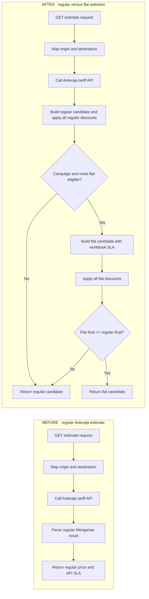

Load the `phasecraft` skill and perform only the Plan stage for `$ARGUMENTS`. Run the `plan` preflight. Read confirmed decisions, evidence, current repository content, and source hashes. Treat stale authority/evidence and execution-critical unknowns as visible planning risks: refresh affected facts when practical, otherwise preserve the uncertainty for human disposition instead of automatically restarting or blocking planning.

Run `knowledge-check` and record stale or missing authorities with their affected claims. Create or update `plan/ROADMAP.md` for all phases. From `verified` or `verified_pending`, select the next executable roadmap phase with `phase-start`; from `verification_failed` or `plan_draft`, revise the active phase instead. Write detailed restricted-schema `PLAN.md` only under the active `plan/phases/P-NN-<slug>/`. If `plan/DEFERRED-FINDINGS.md`, `plan/RISK-REGISTER.md`, or a prior `PLAN-VERIFICATION.md` exists, read every open entry and accepted disposition. Bring due entries into the active phase when their owner phase starts, materialization signal is observed, or trigger is now true; otherwise preserve them without expanding the current plan. Never silently discard, close, or repeatedly re-audit a human-deferred or accepted item before its trigger.

On a revision, classify the requested correction before investigating. A changed user preference is a decision; a changed claim about current behavior needs repository evidence; a proposal remains proposed; a wording-only correction needs no evidence refresh. Reuse every current evidence entry whose source hash is unchanged. Refresh only stale sources and gather new evidence only for changed claims or newly affected code/data paths. Before editing any plan that already has a hash-bound `PLAN-VERIFICATION.md`, run `archive-plan` with the next unused version so the prior plan, HTML, and audit remain available for differential verification. Record old/new hashes, changed semantic IDs, directly affected dependencies, evidence changes, and carry-forward dispositions in the planner handoff.

## Authoritative Technical Content

For every `CH-*`, inspect the actual repository symbol and record all structured fields: `Change type`, `File`, `Symbol`, evidence-backed `Before`, clearly labeled `Proposed after`, `Reason`, `Database changes`, `API changes`, and `Flow impact`. Use exact `none` only after confirming that category has no impact.

Every change must include fenced `#### Before code`, `#### Proposed code`, and `#### Expected result` blocks with an accurate language identifier such as `js`, `ts`, `json`, `sql`, `bash`, or `text`. The before block must quote the relevant current implementation or explicitly state that the file/symbol does not exist. The proposed block must be an implementation-ready code, schema, configuration, payload, or test snapshot. The expected-result block must show the concrete post-change output reviewers should expect: persisted document/config shape, index listing, API response/payload, returned object, emitted event, generated report, or test observation. Do not substitute prose or pseudocode that hides function signatures, control branches, arguments, return shape, persistence, error handling, or integration boundaries.

If `Database changes` is not exactly `none`, add fenced `#### Database migration` and `#### Rollback plan` blocks. Show collection/document/index changes, write ordering, backfill or promotion behavior, compatibility, and the safest rollback. Its `Expected result` must include a realistic complete persisted example, including defaults, required control fields, representative version/provenance values, and absence of forbidden fields. For a new `GlobalSettings(type=anterajaFlat)` record, show the expected `type` and full `data` object with `enabled`, configured date placeholders, timezone, and coverage version. Never imply SQL for a Mongo project or destructive cleanup where restoring a previous version/control is safer. State public and internal contract changes accurately in `API changes`, and show changed request/response examples in `Expected result`.

## Application Flow Changes

Trace user-facing application behavior from its real entry point through routes/controllers/jobs, services, helpers, models/cache, persistence, and external calls. Do not use a low-level validator, index, migration, or test-tool flow as the primary feature diagram. `Flow impact` on each `CH-*` must use exact `none` or reference one or more `F-*` entries that the change supports.

Add an `Application Flows` section after `Technical Design`. Include one `F-*` entry for every materially affected surface, including known future-phase surfaces. Mark its owning `Phase` so a feature-wide flow does not authorize implementation outside the active phase. At minimum, distinguish estimate/rate lookup, initial order creation, retry/pay-later creation, weight recheck, persistence/archive, and outbound integration when they differ.

Every application flow requires `Surface`, real `Entry point`, owning `Phase`, evidence-backed `Before`, labeled `After`, and `Evidence`, followed by a Mermaid `#### Diagram`. Use `flowchart LR` with separate `BEFORE` and `AFTER` subgraphs, `direction TB` inside each lane, and no crossover edges between lanes. This produces two side-by-side vertical sequences instead of one tangled graph. Use concise symbol/behavior labels, decision diamonds, and labeled yes/no branches. Show business data and side-effect ordering, not every helper call.

````markdown
## Application Flows
### F-001: Anteraja estimate price selection
- Surface: Anteraja estimate API
- Entry point: server/services/order/getEstimate/getEstimate.js:getEstimate
- Phase: P-02
- Before: E-011 maps addresses, requests the Anteraja tariff, and returns the regular result.
- After: PROPOSED P-008 compares fully discounted regular and eligible flat candidates and returns the lower final seller result.
- Evidence: E-003, E-008, E-011, D-004, D-007, D-019, P-008

#### Diagram


#### Change points
```changes
A4 | P-02 | server/services/order/getEstimate/getEstimate.js | getEstimate | Preserve the normalized tariff result as the regular comparison candidate.
A5 | P-02 | server/services/order/getEstimate/getEstimate.js | getEstimate | Apply every existing regular seller discount before comparison.
A6 | P-02 | server/services/order/anteraja/flatRateSelection.js | resolveAnterajaFlatSelection | Insert campaign and directional coverage eligibility after the tariff response.
A7 | P-02 | server/services/order/anteraja/flatRateSelection.js | buildFlatCandidate | Build Rp9,000 rounded-weight price with workbook SLA.
A8 | P-02 | server/services/order/anteraja/flatRateSelection.js | buildFlatCandidate | Apply every flat candidate discount before comparison.
A9 | P-02 | server/services/order/anteraja/flatRateSelection.js | selectFinalCandidate | Compare final seller amounts and select flat on equality.
```
````

Every `F-*` must include a fenced `#### Change points` block using language `changes`. Each line uses `Mermaid node | Phase | File | Symbol | Surgical change`. Map every AFTER node that inserts, changes, or redirects application behavior to the exact file and symbol where the edit will occur. The node must exist in the Mermaid diagram. Do not map display-only start/end nodes unless code changes there. For known future phases, map the expected file/symbol from repository evidence and keep its owning phase explicit; later just-in-time planning must re-verify it.

For order creation, diagram the actual order entry surface, resolver insertion point, persistence of both `true` and `false` before the external `/order` side effect, retry/pay-later reuse of frozen classification, `is_flat_rates` payload mapping, errors, and unchanged Cargo/non-Anteraja paths. Map each changed node to its exact service/model/helper symbol. For estimates, show tariff API use, eligibility timing, complete discount stages for both candidates, final comparison, tie policy, selected SLA, and regular fallback, then map the candidate construction, discount, eligibility, comparison, and response selection nodes. A task dependency diagram or an internal configuration flow is not a substitute.

## Tasks And Manual Evidence

Every task must include requirements, evidence, dependencies, files, change, verification observations separated by semicolons, and a commit group. Aim for at least two meaningful observations per requirement, but treat insufficient observation diversity as a reviewable completeness risk rather than inventing duplicate checks. Include risk impact, the current mitigation or explicit `none` decision, possible solution, negative checks, boundary checks, and human-only checks in proportion to active-phase risk.

Write each `M-*` as one independently executable manual procedure. `Instructions` must include preconditions, exact command or user action, required safe environment/data, where to inspect the result, and cleanup when applicable. `Expected` must describe concrete observable output and failure conditions, not merely "works" or "looks correct". Keep one verification scenario per entry; the HTML renderer displays each entry as one full-width row.

## HTML Artifact Review

Validate Markdown, then render each artifact with its own runtime view; never hand-author or copy HTML between artifacts. Resolve every `E-*`, `D-*`, `P-*`, `U-*`, and `R-*` identity against the evidence registry so the generated reference index exposes its claim, provenance, and status.

`roadmap.html` must visibly identify itself as the whole-work/all-phases strategic map: phase sequence, declared dependencies, statuses, requirement ownership, exit evidence, risks, unresolved unknowns, and references. `plan.html` must prominently show the current executable `P-NN`, state that it authorizes only that phase, and label application flows owned by other phases as `Future context`. It then reads as an implementation review artifact: syntax-highlighted before/proposed code and expected results, Mermaid application-flow comparisons, surgical node-to-file/symbol tables, database/API/flow impact panels, migrations and rollback, requirement coverage, dependency-aware task order, file impact, risk controls, row-based manual checks, commit groups, and references. Every `CH-*` flow-impact panel must visibly retain its `F-*` relationship. Syntax highlighting and flowcharts come only from authoritative fenced Markdown. The HTML loads the pinned Mermaid renderer and leaves readable Mermaid source as fallback if the renderer is unavailable.

Inspect both generated files structurally, without launching a browser. Confirm the roadmap says `All phases`; the plan's `<title>`, metadata, banner, and footer identify the same current executable phase; and every flow badge correctly says `Current phase` or `Future context`. In `plan.html`, confirm code and expected-result snapshots have language labels and deterministic token spans; database changes show concrete resulting documents/config/indexes; each application flow retains validator-accepted Mermaid source with separate BEFORE/AFTER lanes, correct business steps, and branches; every changed AFTER node appears in the surgical change table with a credible phase/file/symbol; no diagram source has crossing before/after connectors or uses an internal mechanism as the feature flow; no required panel says `Not supplied in PLAN.md`; database/API/flow/rollback information is present; manual checks are one item per row; and evidence links resolve. Confirm the generated HTML carries the current Markdown source hash, pinned Mermaid runtime, readable source fallback, and expected structural markers. The renderer adds task/phase dependency diagrams only when relationships make them useful. Do not add decorative diagrams unsupported by the plan.

Do not use Playwright, browser automation, screenshots, rendered-SVG inspection, or a visual-layout gate during Plan. The restricted validator is the agent gate for Mermaid source syntax and structure; a human may open the generated HTML and request a later visual revision.

After inspection, transition through `roadmap_ready` to `plan_draft`. If revising any already-audited plan, archive the prior Markdown, HTML, and available verification under `versions/vN/` with hashes and a supersession reason first. Stop before plan verification.

Run `handoff-list --all` and read the latest prior-stage plus all planner handoffs before planning. Before every return, invoke `handoff-write --agent phasecraft-planner` with exact inputs, evidence, artifacts, validations, blockers, and next action, including blocked and repeated replanning rounds; never allocate `H-NNN.md` manually.
